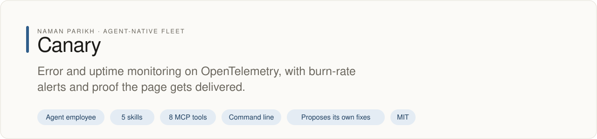
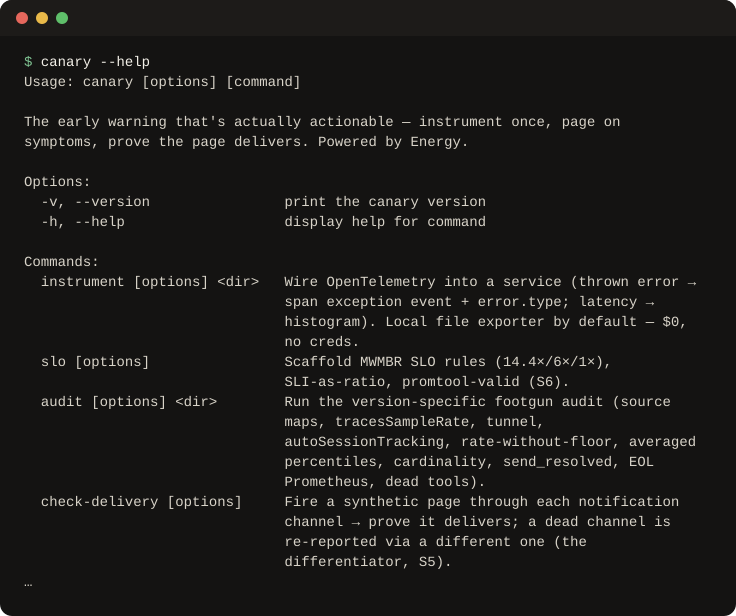

# canary

<!-- fleet:header:start -->
<p align="center"><picture><source media="(prefers-color-scheme: dark)" srcset="assets/banner-dark.svg"></picture></p>

<p align="center">
<a href="https://github.com/naman10parikh/canary/actions/workflows/ci.yml"></a>
<a href="https://github.com/naman10parikh/canary/releases"></a>
<a href="LICENSE"></a>
<a href="#use-it-from-any-coding-agent"></a>
<a href="https://x.com/naman10parikh"></a>
<a href="https://www.linkedin.com/in/naman-parikh1/"></a>
</p>

<p align="center"><a href="#quick-start">Quick start</a> · <a href="docs/README.md">How it works</a> · <a href="AGENTS.md">AGENTS.md</a> · <a href="llms.txt">llms.txt</a> · <a href="skills/">Skills</a> · <a href="https://github.com/naman10parikh/canary/discussions">Discussions</a> · <a href="https://github.com/naman10parikh">All projects</a></p>

**Error and uptime monitoring on OpenTelemetry, with burn-rate alerts and proof the page gets delivered.**

Canary is an agent employee, a packaged specialist agent with its own skills, memory and tests. It owns one job: errors and uptime. Coding agents use it through its skills, its MCP server and its command line. A scheduled job runs its evals and proposes fixes. A person makes every change.

_Canary is part of an agent-native play for agent-native systems that can eventually be recursively self-improving and evolving, operated by agent employees._

<p align="center"></p>
<!-- fleet:header:end -->

## What it is

canary is a site reliability engineer that any coding agent can call. It instruments a service once
with OpenTelemetry, writes SLO burn-rate alerts that pass `promtool`, audits monitoring config for
known footguns, and proves that each alert page is actually delivered. It is for teams and agents that
ship services and want fewer, truer pages; it covers app health only and leaves LLM token spend to its
sibling [agentmoney](https://github.com/naman10parikh/agentmoney).

<!-- fleet:use:start -->
## Use it from any coding agent

**Claude Code**: the plugin brings the skills, sub-agents, hooks and MCP server.

```
/plugin marketplace add naman10parikh/canary
/plugin install canary@canary
```

<details><summary>Its MCP server, Codex, Cursor, Gemini CLI, one skill and the command line</summary>

**Its MCP server**, in any MCP client:

```bash
claude mcp add --transport stdio canary -- npx -y -p github:naman10parikh/canary canary-mcp
codex mcp add canary -- npx -y -p github:naman10parikh/canary canary-mcp
```

Cursor (`.cursor/mcp.json`), Gemini CLI (`.gemini/settings.json`) and most other clients take the same command as JSON:

```json
{
  "mcpServers": {
    "canary": {
      "command": "npx",
      "args": [
        "-y",
        "-p",
        "github:naman10parikh/canary",
        "canary-mcp"
      ]
    }
  }
}
```

**Gemini CLI**: the extension brings the context and the MCP server.

```bash
gemini extensions install https://github.com/naman10parikh/canary
```

**One skill** (5 in all, in [skills/](skills/)), in any agent that reads Agent Skills:

```bash
gemini skills install https://github.com/naman10parikh/canary --path skills/instrument-with-otel
git clone --depth 1 https://github.com/naman10parikh/canary /tmp/canary && cp -r /tmp/canary/skills/instrument-with-otel ~/.claude/skills/
```

**The command line:**

```bash
npx -y -p github:naman10parikh/canary canary --help
```

</details>

Codex, Cursor, OpenCode, GitHub Copilot and other agents read [AGENTS.md](AGENTS.md); Claude Code reads [CLAUDE.md](CLAUDE.md) and Gemini CLI reads [GEMINI.md](GEMINI.md), which import it. [llms.txt](llms.txt) maps every surface for agents that read first.
<!-- fleet:use:end -->

## Quick start

You need Node.js 22 or later and pnpm.

```bash
git clone https://github.com/naman10parikh/canary && cd canary
pnpm install && pnpm build

# Find the footguns planted in a broken sample service (it reports 12 critical findings)
node dist/cli/index.js audit eval/fixtures/broken-service

# Write SLO burn-rate alert rules for a 99.9% target (checked with promtool when it is installed)
node dist/cli/index.js slo --service checkout --target 99.9 --out ./slo

# Prove pages arrive: the webhook has no URL, so it is dead and canary reports it through the backup
CANARY_DELIVERY_CHANNELS='[{"name":"pager","type":"webhook"},{"name":"backup","type":"mock"}]' \
  node dist/cli/index.js check-delivery

# Read one battle-tested scenario from the brain by its ID
node dist/cli/index.js explain S5

# Run the tests and the evals (L1 structural, L2 behavioral, pass^3)
pnpm test && pnpm eval
```

Without a clone, `npx -y -p github:naman10parikh/canary canary --help` runs the command line straight
from GitHub.

## How it works

- **Instrument once.** `canary instrument <dir>` writes an OpenTelemetry bootstrap into a service. A
  thrown error becomes a span `exception` event with `error.type`, and latency becomes an
  `http.server.request.duration` histogram. The default exporter writes to a local file, so it costs
  nothing and needs no keys.
- **Page on symptoms.** `canary slo` writes a multi-window, multi-burn-rate rule set (14.4x and 6x page,
  1x ticket). The SLI is a ratio of good to total requests, never a raw quantile.
- **Catch footguns before they ship.** `canary audit` and `canary cardinality` find the mistakes listed
  in `brain/KNOWN-PITFALLS.md`, each with a section ID, a detection and a fix. The footgun gate hook
  blocks a commit that adds one.
- **Prove the page arrives.** `canary check-delivery` fires a synthetic page through every channel and
  reports a dead channel through a different, live one.
- **Know why.** The six files in `brain/` hold the expertise: 18 battle-tested scenarios, version-specific
  pitfalls, the tool matrix and the opinions. `canary brain "<query>"` searches them with BM25, and
  `canary explain <id>` prints one entry.
- **Stay in its lane.** canary reads latency and errors off a GenAI span and stops at `gen_ai.usage.*`.
  Token spend belongs to agentmoney.

The default stack is OpenTelemetry, Sentry, Prometheus and Grafana, Checkly, pino, and PagerDuty or
incident.io, with BetterStack as the uptime alternative. Agents reach canary through the `canary`
command line and the MCP server; a person can open the local cockpit with `pnpm serve`
(http://127.0.0.1:7799). It is built on the Energy harness formula: one repository is one agent
employee, with its identity, memory, skills, hooks, sub-agents and MCP server inside it.

<!-- fleet:anatomy:start -->
## What it is made of

Every project in this fleet is graded on the same 11 harness components and on self-improvement. Each mark is backed by a file you can open.

| Component | Grade | Where |
| --- | --- | --- |
| Identity | ✅ | identity/SOUL.md:9 |
| Memory | ✅ | MEMORY.md:1, scripts/memory-search.sh:121, memory/LEARNINGS.md:5 |
| Skills | ✅ | skills/test-alert-delivery/SKILL.md:1 (5 skills) |
| Tools/CLIs | ✅ | package.json:7 |
| Hooks | ✅ | .claude/settings.json:4, hooks/hooks.json:3 |
| Sub-agents | ✅ | .claude/agents/observability-auditor.md:2, .claude/agents/alerting-reviewer.md:2 |
| MCPs | ✅ | src/mcp/tools/index.ts:59, .mcp.json:3 |
| Dispatch | ✅ | src/dispatch/run-loop.ts:34, .github/workflows/rsi.yml:15 |
| Evals | ✅ | eval/, .github/workflows/acceptance.yml:76 |
| Observability | ✅ | src/observability/run-logger.ts:95, logs/runs.jsonl |
| Sandbox/Infra | ✅ | eval/sandbox/boot-e2b.mjs:115 |
| Self-improvement | ✅ | dsip.json:5, .github/workflows/rsi.yml:15, .github/workflows/rsi.yml:49 |

✅ real and tested · 🟡 partial, with the reason in the row · ❌ absent
<!-- fleet:anatomy:end -->

<!-- fleet:footer:start -->
## How it improves itself

It carries its own evals and a self-improvement contract, [`dsip.json`](dsip.json), which says what it may change and how a change is judged. A scheduled job runs its evals and proposes fixes. A person makes every change. Lessons it learns are kept as rules in its memory files.

## Part of a fleet

One of the projects by [Naman Parikh](https://github.com/naman10parikh). Each owns one part of an agent's harness, or of the product around an agent, and all of them follow one standard.

| Related project | What it owns |
| --- | --- |
| [AgentDial](https://github.com/naman10parikh/agentdial) | Identity |
| [WikiMem](https://github.com/naman10parikh/wikimem) | Memory |
| [Skillsmith](https://github.com/naman10parikh/skillsmith) | Skills |
| [Agent Booster](https://github.com/naman10parikh/agent-booster) | Tools / CLIs |
| [Armory](https://github.com/naman10parikh/armory) | MCPs and the component registry |
| [AgentGrid](https://github.com/naman10parikh/agentgrid) | Dispatch |
| [AgentSwarm](https://github.com/naman10parikh/agentswarm) | Dispatch |
| [AgentBench](https://github.com/naman10parikh/agentbench) | Evals |
| [AgentMoney](https://github.com/naman10parikh/agentmoney) | Observability |
| [Claude Harness](https://github.com/naman10parikh/claude-harness) | The whole harness, as a template |

## Community

Questions and ideas go to [Discussions](https://github.com/naman10parikh/canary/discussions); bugs go to [issues](https://github.com/naman10parikh/canary/issues/new/choose). Follow the work on [X](https://x.com/naman10parikh) and [LinkedIn](https://www.linkedin.com/in/naman-parikh1/).

## Contributing and security

Read [CONTRIBUTING.md](CONTRIBUTING.md). AI-assisted pull requests are welcome. Report a vulnerability privately, as [SECURITY.md](SECURITY.md) explains.

## License

MIT, © 2026 Naman Parikh. See [LICENSE](LICENSE) and [NOTICE](NOTICE).
<!-- fleet:footer:end -->
