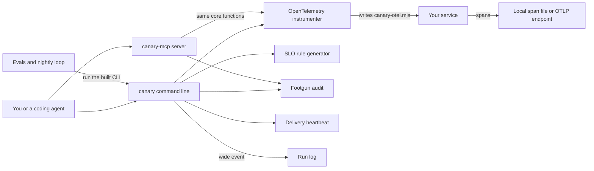

# How Canary works

Canary is an error and uptime monitoring helper for developers and coding agents.
It adds OpenTelemetry to a Node service, so a thrown error becomes a trace span you can read.
OpenTelemetry is the open standard for traces, metrics and logs.
Canary also writes SLO alert rules, audits monitoring setups for known mistakes and tests that alerts really arrive.
An SLO, a service level objective, is a target such as 99.9 percent of requests succeeding.
Its default path writes to a local file, so it needs no account, no key and no model.

## The parts



The command line starts in [src/cli/index.ts](../src/cli/index.ts), which registers one command per module from [src/cli/commands/](../src/cli/commands/).
Every command runs inside `runCommand` from [src/lib/cli-result.ts](../src/lib/cli-result.ts), which prints JSON or text and maps errors to exit codes.
The MCP server in [src/mcp/server.ts](../src/mcp/server.ts) uses the official MCP SDK and registers 8 tools from [src/mcp/tools/index.ts](../src/mcp/tools/index.ts).
MCP, the Model Context Protocol, lets an agent call tools by name.
`canary brain` and `canary explain` read the Markdown notes in [brain/](../brain/), the first through [scripts/memory-search.sh](../scripts/memory-search.sh).

The instrumenter is [src/instrument/otel.ts](../src/instrument/otel.ts), and the SLO generator is [src/slo/sloth-gen.ts](../src/slo/sloth-gen.ts).
The audit in [src/audit/](../src/audit/) walks a folder once and runs each detector from [src/audit/detectors/](../src/audit/detectors/).
A footgun here is a setting that looks fine but hides errors or wastes money, such as sampling every trace in production.
[src/delivery/heartbeat.ts](../src/delivery/heartbeat.ts) sends a test page through each alert channel.
`instrument` appends a wide event, one JSON line with a trace id and a duration, through [src/observability/run-logger.ts](../src/observability/run-logger.ts).
The evals in [eval/](../eval/) and the loop in [workflows/rsi.workflow.js](../workflows/rsi.workflow.js) check all of this.

## What happens when you run it

The main flow instruments a service: `canary instrument ./my-service`.

1. The `canary` bin runs `dist/cli/index.js`, built from [src/cli/index.ts](../src/cli/index.ts) by `pnpm build`.
2. [src/cli/commands/instrument.ts](../src/cli/commands/instrument.ts) wraps the work in `runCommand` and `withRunLog`.
3. `instrumentService` in [src/instrument/otel.ts](../src/instrument/otel.ts) checks that the folder exists. A missing folder raises a `NOT_FOUND` error.
4. `parseOtlpTarget` reads `--otlp`. The default, `file://.otel-out`, writes spans to a local file. An `http://` or `https://` value sends real OTLP data there.
5. The service name comes from the folder's `package.json`, or from the folder name.
6. Canary writes `canary-otel.mjs` into the folder. It sets up HTTP auto-instrumentation and an exporter, and needs only the OpenTelemetry packages.
7. With `--sentry`, it also writes `canary-sentry.config.mjs`, a source map config for your build. It does not upload anything.
8. It returns the files it wrote, the exporter and a proof command, as text or JSON.
9. `withRunLog` appends the run to `logs/runs.jsonl` in the current folder.
10. You start the service with `node --import ./canary-otel.mjs <entry>`. A thrown error then becomes a span with an `exception` event and an `error.type` attribute.

In CI, [.github/workflows/acceptance.yml](../.github/workflows/acceptance.yml) instruments [eval/fixtures/sample-service/](../eval/fixtures/sample-service/).
[eval/boot-and-throw.mjs](../eval/boot-and-throw.mjs) then boots it, hits a route that throws, and reads the span file to prove the error was captured.
The same job checks the SLO rules with `promtool` and fails on any critical audit finding.

## Extending it

- **A command.** Add a module with a `registerX(program)` function in [src/cli/commands/](../src/cli/commands/). Call it in `buildProgram` in [src/cli/index.ts](../src/cli/index.ts).
- **An MCP tool.** Call `server.registerTool` in `registerCanaryTools` in [src/mcp/tools/index.ts](../src/mcp/tools/index.ts). Add the name to `CANARY_TOOL_NAMES`, which [tests/mcp.test.ts](../tests/mcp.test.ts) checks.
- **An audit detector.** Add it to one of the files in [src/audit/detectors/](../src/audit/detectors/), keyed by its id in [brain/KNOWN-PITFALLS.md](../brain/KNOWN-PITFALLS.md). It joins `ALL_DETECTORS` in [src/audit/detectors/index.ts](../src/audit/detectors/index.ts). Cover it in [tests/audit.test.ts](../tests/audit.test.ts).
- **A skill.** Create `skills/<name>/SKILL.md` with `name` and `description` front matter, like [skills/instrument-with-otel/SKILL.md](../skills/instrument-with-otel/SKILL.md).
- **An eval.** Add a structural test to [eval/L1/](../eval/L1/) or a behavior test to [eval/L2/](../eval/L2/). Graded plans go in [eval/L3/](../eval/L3/) as Markdown rubrics.

Run these before you push:

```bash
pnpm install
pnpm build
pnpm test
pnpm eval
pnpm test:e2e
```

## Questions

**Does it need an API key or cost money?**
No key is needed for `instrument`, `slo`, `audit`, `cardinality`, `brain`, `explain`, `eval` or the MCP server.
`check-delivery` uses a free in-process `mock` channel by default. A `webhook` channel posts to the URL you configure.
`pnpm acceptance` boots the sample service inside an E2B sandbox and needs `E2B_API_KEY`, on your own E2B account.

**Does any data leave the machine?**
By default spans go to a local file and nothing is sent.
With an `http://` or `https://` value for `--otlp`, your service sends its traces to that endpoint.
`check-delivery` posts a test event to each webhook channel you configure.
If `CANARY_HEARTBEAT_URL` is set, the nightly check-in is sent to that URL.
The nightly loop asks npm for the latest package versions, and the cockpit in [web/server.mjs](../web/server.mjs) listens on 127.0.0.1 only.

**How does it improve itself?**
[dsip.json](../dsip.json) declares the `agent` level, with a nightly loop and no self-grading.
[.github/workflows/rsi.yml](../.github/workflows/rsi.yml) runs `node workflows/rsi.workflow.js --deterministic` every day at 09:00 UTC.
The loop checks pinned npm packages for newer versions with `npm view`.
It also checks that the brain still warns about tools that were shut down or archived.
It runs `canary eval`, writes a proposal under `.rsi/`, and CI uploads it for a person to review.
The loop never commits. It then runs [scripts/dogfood-checkin.mjs](../scripts/dogfood-checkin.mjs) to prove the scheduled run happened.

**How do I run its tests or evals?**
`pnpm test` runs the Vitest suites in [tests/](../tests/).
`pnpm eval` builds Canary and runs `canary eval`. It runs the level 1 and level 2 suites, and repeats level 2 three times by default.
`canary eval --level 3` lists the plan rubrics in [eval/L3/](../eval/L3/), which a reviewer grades.
`pnpm test:e2e` runs the Playwright tests for the command line and the cockpit.

**What does it not do?**
`release-health` and `uptime` are planned commands. They explain what they will do and exit with an error.
The `release_health` MCP tool returns a planned status, not a recommendation.
It does not run your service or host your dashboards. Your OTLP backend or local file holds the data.
The routing loop in [src/dispatch/run-loop.ts](../src/dispatch/run-loop.ts) chains instrument, SLO and audit steps, but only its tests call it today.
